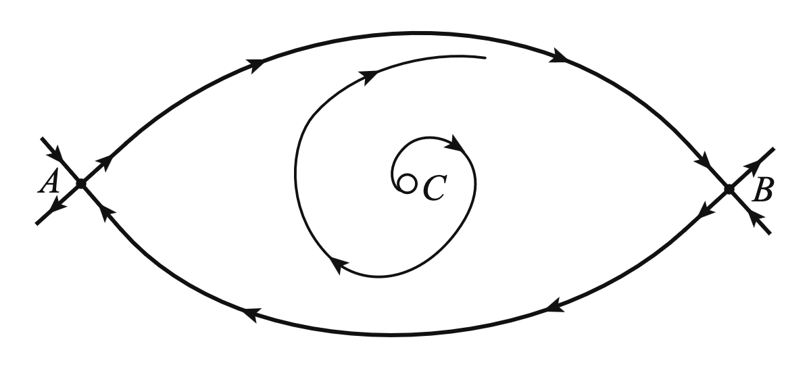

# Phase Portrait Sketcher

A browser tool for sketching qualitative phase portraits of planar flows, as used in a dynamical systems course. The tool checks that the picture is topologically consistent, for example that trajectories do not cross and that every attachment respects the direction of the flow.

**▶ [Open the app](https://jansieber.github.io/phaseplane-sketching/)** – runs in any modern browser, including iPad and Android tablets.

## Features

* Trajectories as editable Bézier curves, drawn freehand or with a pen. Their ends snap to equilibria, separatrices, periodic orbits and boundaries; trajectories can be joined and split.
* Sinks, sources, foci and saddles with four separatrix terminals; stable, unstable and semi-stable periodic orbits; inflow and outflow boundaries for trapping regions.
* Consistency checks: crossings, flow direction, and the index sum inside orbits. Inconsistent edits can optionally be refused.
* A structural-stability switch. When it is off, codimension-one elements are allowed: saddle-nodes, semi-stable orbits and saddle connections.
* Export to PDF cropped for LaTeX, TikZ, SVG and PNG, plus printing.
* Copy and paste of sketches between drawings, and copying images to the clipboard for note-taking apps.
* A single self-contained `index.html` with no dependencies. It also works offline: download it and open it from disk.

## Documentation

* [HELP.md](HELP.md) – user guide: tools, keyboard shortcuts, consistency checks, files and export.
* [PLAN.md](PLAN.md) – requirements, design decisions and implementation notes.
* [phaseplane-examples.json](phaseplane-examples.json) – example drawings; load them via *Library… → Import…*.
